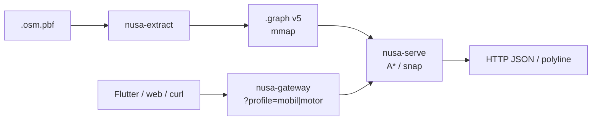

# Nusapeta Route

**Router jalan Indonesia yang muat di sidecar.** Satu binary Go, graph OSM
`mmap`, weighted A*, tanpa dependency runtime.

[](go.mod)
[](LICENSE)
[](https://www.openstreetmap.org/copyright)
[](#batasan)

> **English:** Nusapeta Route is a memory-mapped OpenStreetMap router for Indonesia.
> It compiles an `.osm.pbf` into one binary graph and serves short-to-medium
> routes over HTTP. The design target is cost per route — RAM, artifact size,
> and rebuild time — not raw query latency.

## Kenapa

Aplikasi ride-hailing, logistik, dan field service biasanya hanya butuh dua
koordinat, satu polyline yang mengikuti jalan, jarak, dan ETA kasar untuk rute
≤100 km. Hosted Directions API membebankan biaya per request. OSRM, GraphHopper,
dan Valhalla gratis per request, tetapi dirancang untuk query panjang dan
memakai RAM ratusan MB sampai beberapa GB.

Nusapeta Route mengambil trade-off sebaliknya:

- **Graph dipetakan, bukan disalin ke heap.** Halaman yang tidak disentuh tidak
  masuk RSS; graph nasional 1,6 GB tetap bisa idle di 11 MB.
- **Satu artefak untuk mobil dan motor.** Format v5 menyimpan dua tabel kelas
  kecepatan dan dua set turn restriction dalam satu file.
- **Rebuild murah.** Ekstraksi Java 28 detik di mesin uji; graph nasional 1
  menit 12 detik setelah PBF tersedia.
- **Hasil bisa diaudit.** `/healthz` membawa provenance PBF, versi format,
  jumlah node/edge, dan statistik restriction.

Trade-off-nya nyata: tanpa hierarki CH/MLD, Nusapeta Route **bukan** engine tercepat.
Pada E1, OSRM MLD sekitar 26× lebih cepat di p50. Keunggulan Nusapeta Route ada di
memori, ukuran artefak, dan preprocessing.

## Snapshot terukur

E1: Java, mesin yang sama (Ryzen 5 5600G), PBF yang sama, 600 pasangan identik.
Angka lengkap dan perintah reproduksi ada di
[`paper/RESULTS.md`](paper/RESULTS.md) §13 dan §18.

| | Nusapeta Route (Java, E1) | OSRM MLD v5.26.0 |
|---|---:|---:|
| Graph di disk | **693 MB** (1 file) | 5,08 GB (banyak file) |
| RSS sebelum query | **17 MB** | 2,36 GiB |
| Preprocess | **28 s** | 250 s (peak 6,25 GB) |
| p50, 332 pasangan cocok | 38,7 ms | **1,5 ms** |
| p95, 332 pasangan cocok | 674 ms | **3,7 ms** |
| Selisih jarak, 332 pasang | median 0,23%, p95 14,49%, max 70,44% | referensi |
| Gagal / dibuang | 79 gagal (72 `snap`, 7 `budget`); 189 dibuang filter snap | — |

E1 adalah perbandingan antar-engine, **bukan validasi akurasi**: keduanya
memakai graph OSM. Ground truth independen (E2) tidak dijalankan. Karena itu
README ini tidak mengklaim "paling akurat".

Graph nasional saat ini:

| metrik | nilai |
|---|---:|
| Node / edge | 54.891.393 / 112.340.071 |
| Format | v5 `car+motor`, Hilbert order |
| Artefak | 1.621 MB |
| Idle RSS | 11,1 MB (`RssAnon` 4,5 MB) |
| 4× rute 96 km paralel | 225 MiB RSS (`anon` 90 MiB) |
| Build | 11m40s termasuk unduh; ekstraksi 1m12s |

Beban 600 pasangan Jawa dengan batas 100 km di Ryzen: 481 sukses, p50 39–47 ms,
p95 0,94–1,32 s. Di i3-6100T: 472 sukses; 72 gagal snap, 40 `too_far`, 16
`budget`. Detail dan batas klaim ada di
[`docs/BENCHMARKS.md`](docs/BENCHMARKS.md).

## Quick start

Butuh Go 1.27+ dan `make`.

```bash
git clone https://github.com/nusapeta/route.git
cd route

make build                 # semua binary ke bin/
make java                  # unduh PBF Jawa + build data/java.graph
bin/nusa-serve -graph data/java.graph -addr 127.0.0.1:8080
```

Di terminal lain:

```bash
curl -s 'http://127.0.0.1:8080/route?from=-6.1754,106.8272&to=-6.5950,106.8166&format=polyline' \
  | jq '{distance_m, duration_s, points_n, snap_from, snap_to}'
```

Graph nasional (butuh ±1,7 GB PBF dan ±5 GB RAM saat build):

```bash
GOMEMLIMIT=5GiB scripts/build-national.sh
bin/nusa-serve -graph data/indonesia.graph -addr 127.0.0.1:8080
```

Dua profil di satu base URL memakai `nusa-gateway`:

```bash
bin/nusa-serve -graph data/indonesia.graph -profile car   -addr 127.0.0.1:18080
bin/nusa-serve -graph data/indonesia.graph -profile motor -addr 127.0.0.1:18081
bin/nusa-gateway -addr 127.0.0.1:8080
curl '127.0.0.1:8080/route?...&profile=motor'
```

## Arsitektur



- **Ekstraksi sekali, query berkali-kali.** `nusa-extract` membaca PBF, menulis
  header + section ter-align, lalu server membuka file dengan `mmap`.
- **Node adalah node OSM.** Geometri jalan tidak disederhanakan; tidak ada tabel
  shape point terpisah.
- **CSR + fixed point.** `Off`/`To` 32-bit, `Len` 16-bit satuan 4 m, `Cls`/`MCls`
  8-bit (km/h × 2), koordinat 1e-7. Satu edge 8 B; satu node 12 B.
- **Hilbert ordering.** Node diurutkan secara geografis agar frontier A* tetap
  page-local.
- **Edge-based A*.** State adalah edge yang baru dilewati, sehingga turn
  restriction `(edge masuk, edge keluar)` bisa ditegakkan tanpa tabel dense.
- **Snap ke ruas.** Titik diproyeksikan ke segmen, lalu hasil dir trimming atau
  diberi spur; polyline mulai dan berakhir di jalan.
- **Dua profil, satu graph.** Mobil dan motor punya tabel kelas dan restriction
  sendiri; proses server memilih salah satu lewat `-profile`.

Detail format, invarian, dan alasan desain:
[`docs/ARCHITECTURE.md`](docs/ARCHITECTURE.md).

## API singkat

| Endpoint | Guna |
|---|---|
| `GET /route?from=lat,lng&to=lat,lng` | rute; `format=json\|points\|geojson\|polyline` |
| `POST /route` | body JSON `{from,to,format,simplify,restrictions,pin}` |
| `GET /healthz` | kesiapan + provenance graph |
| `GET /version` | commit, build time, Go/OS/arch |
| `GET /metrics` | Prometheus (biasanya hanya upstream internal) |
| `GET /` | demo peta di `nusa-gateway` |

Parameter penting: `simplify=<meter>`, `pin=1` (garis menyambung pin mentah),
`restrictions=0` (matikan enforcement untuk debug), `profile=mobil|motor`
(hanya di gateway). Error `422`/`504` membawa `reason`:
`snap`, `too_far`, `budget`, `no_route`, `cross_region`, `deadline`.

Contoh respons:

```json
{
  "distance_m": 56451,
  "duration_s": 2538.8,
  "polyline": "...",
  "snap_from_m": 4,
  "snap_to_m": 24,
  "snap_from": [3.595201, 98.672160],
  "snap_to": [3.600212, 98.485017],
  "trimmed": {"from": true, "to": true},
  "bbox": [3.59, 98.48, 3.60, 98.68],
  "points_n": 412
}
```

Kontrak lengkap, cache/ETag, rate limit, dan integrasi Flutter:
[`docs/API.md`](docs/API.md).

## Build dan operasi

| Perintah | Guna |
|---|---|
| `make build` | semua binary ke `bin/` |
| `make static` | binary statis untuk image Alpine |
| `make test` | `go vet` + seluruh test |
| `make java` / `make sumatra` | unduh + build satu region |
| `make islands` | tujuh region Geofabrik |
| `make refresh REGION=java` | unduh ulang, build, tagstats, test, A/B |
| `scripts/build-national.sh` | satu graph Indonesia (v5) |
| `scripts/smoke.sh <base-url>` | smoke test HTTP |

Deploy Docker Compose, systemd, Cloudflare Tunnel, refresh graph, dan batas
memori: [`docs/OPERATIONS.md`](docs/OPERATIONS.md) dan
[`deploy/README.md`](deploy/README.md).

**Keamanan:** server tidak punya autentikasi. Bind ke loopback dan taruh di
belakang reverse proxy/TLS; rate limit per IP aktif secara default
(`-rate 15 -burst 5`). Jangan expose `/metrics` ke publik.

## Struktur repo

```text
cmd/nusa-extract      PBF -> .graph (offline, bulanan)
cmd/nusa-serve       HTTP /route, /healthz, /version, /metrics
cmd/nusa-gateway      satu base URL, ?profile=mobil|motor
cmd/nusa-route        CLI satu rute untuk debug
cmd/nusa-graphinfo    inspeksi header, snap, scan lubang data
cmd/nusa-restats      census restriction per profil langsung dari PBF
cmd/nusa-bench        benchmark latency/akurasi
cmd/nusa-restcheck    harness kepatuhan turn restriction
cmd/nusa-tagstats     census tag way untuk profil motor
cmd/nusa-snapcheck    ukur galat snapping

internal/extract     parsing OSM, profil, restriction, Hilbert ordering
internal/graph       format biner, mmap, snapping, A*, workspace
internal/stats       helper statistik

docs/                arsitektur, API, operasi, benchmark, roadmap, backlog
paper/               draf ACM, RESULTS.md, ledger klaim, data mentah
scripts/             fetch, build nasional, smoke, load test, harness OSRM
web/                 demo peta yang di-embed ke gateway
```

## Test dan benchmark

```bash
make test
go test ./internal/graph -run TestGoldenRoutes
scripts/smoke.sh http://127.0.0.1:8080

bin/nusa-bench -graph data/java.graph -pairs paper/results/pairs-java.csv
scripts/loadtest.py http://127.0.0.1:8080 \
  -from -7.8435,110.3929 -to -7.7393,110.3760 -c 4 -n 32
```

Golden test memakai kota sintetis 30×30 dan 48 pasangan node + 48 pasangan snap,
jadi perubahan profil, snapping, atau A* yang tidak disengaja langsung terlihat.
Metodologi dan angka kanonik: [`docs/BENCHMARKS.md`](docs/BENCHMARKS.md).

## Batasan

- **Tidak ada klaim akurasi.** E2 (ground truth independen) tidak dijalankan.
  E1 hanya membandingkan Nusapeta Route dengan OSRM pada graph OSM yang sama; p95
  selisih jarak 14,49% dan maksimum 70,44%.
- **Tanpa traffic real-time.** Kecepatan statis per kelas jalan; ETA bukan
  prediksi kemacetan. `restriction:conditional` dihitung tetapi tidak
  dievaluasi.
- **Tanpa hierarki.** Rute >100 km ditolak `422 too_far` secara default. Dengan
  `-max-route-km 0`, koridor sangat panjang memakai epsilon bertingkat dan bisa
  lambat atau `relaxed=true`.
- **Graph nasional besar.** Artefak 1,6 GB; build butuh ±5 GB RAM. Halaman
  `mmap` yang tersentuh tetap masuk RSS, walaupun bisa direklaim cgroup.
- **Data OSM tidak sempurna.** Jalan baru, akses, dan ferry bisa berbeda dari
  kondisi lapangan. Selalu tampilkan atribusi "© OpenStreetMap contributors".

## Dokumentasi

| Dokumen | Isi |
|---|---|
| [`docs/README.md`](docs/README.md) | indeks dokumen dan status |
| [`docs/ARCHITECTURE.md`](docs/ARCHITECTURE.md) | format graph, A*, snap, restriction, profil |
| [`docs/API.md`](docs/API.md) | HTTP API, error, cache, Flutter |
| [`docs/OPERATIONS.md`](docs/OPERATIONS.md) | build, refresh, deploy, kapasitas, keamanan |
| [`docs/BENCHMARKS.md`](docs/BENCHMARKS.md) | metodologi dan angka kanonik |
| [`docs/ROADMAP.md`](docs/ROADMAP.md) | north star, budget, milestone, non-goals |
| [`docs/BACKLOG.md`](docs/BACKLOG.md) | pekerjaan aktif dan alasan item ditunda |
| [`docs/MOTOR-MODEL.md`](docs/MOTOR-MODEL.md) | batas model motor |
| [`paper/README.md`](paper/README.md) | status draf paper dan cara compile |
| [`paper/RESULTS.md`](paper/RESULTS.md) | semua pengukuran + reproduksi |

## Paper

Draf short paper ACM (`acmart`, `sigconf`, `nonacm`) ada di
[`paper/main.tex`](paper/main.tex). Status: **draf lengkap, E1 selesai, E2
dilewati dengan limitation eksplisit.** Paper belum submitted.

```bash
cd paper
pdflatex main && bibtex main && pdflatex main && pdflatex main
```

## Lisensi dan atribusi

Kode: [MIT](LICENSE). Data: © OpenStreetMap contributors, ODbL. File `.graph`
adalah turunan database OSM dan tetap ODbL. Aplikasi yang memakai Nusapeta Route wajib
menampilkan atribusi OpenStreetMap.
