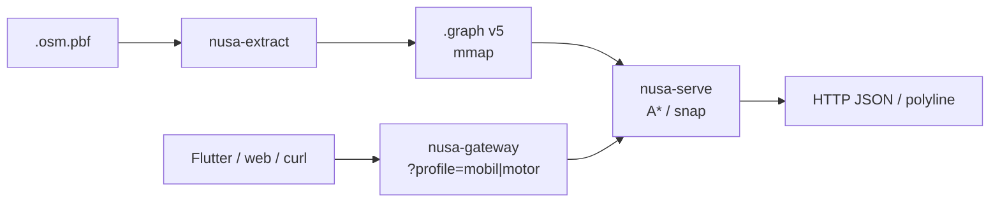

# Nusapeta Route

**An OpenStreetMap road router for Indonesia that fits in a sidecar.** One Go
binary, a memory-mapped graph, weighted A*, no runtime dependencies.

[](https://github.com/nusapeta/route/actions/workflows/ci.yml)
[](go.mod)
[](LICENSE)
[](https://www.openstreetmap.org/copyright)
[](#limitations)

[Bahasa Indonesia](README.id.md) | English

**A self-hosted geo stack for Indonesia: routing + geocoding, one file per
engine, about 48 MB idle, rebuilt in minutes, no database.** This repository is
the routing half; the geocoder is
[`nusapeta/place`](https://github.com/nusapeta/place) and the compose bundle is
[`nusapeta/stack`](https://github.com/nusapeta/stack).

`17 MB` idle RSS · `552 MB` download · `1.6 GB` graph on disk · `28 s` to
preprocess the Java extract. ODbL data, no runtime dependencies.

## Quick start from the release artifact

Requires Docker, curl, zstd, and sha256sum.

```bash
mkdir -p route-data && cd route-data
base=https://github.com/nusapeta/route/releases/download/data-2026.11
curl -fsSLO "$base/indonesia-v5-2026.11.graph.zst"
curl -fsSLO "$base/indonesia-v5-2026.11.graph.zst.sha256"
sha256sum -c indonesia-v5-2026.11.graph.zst.sha256
zstd -d indonesia-v5-2026.11.graph.zst -o indonesia-v5-2026.11.graph

docker run --rm -p 127.0.0.1:8080:8080 -v "$PWD:/data:ro" \
  ghcr.io/nusapeta/route:0.1.0 \
  -graph /data/indonesia-v5-2026.11.graph -addr :8080
```

In another terminal:

```bash
curl -s 'http://127.0.0.1:8080/route?from=-6.1754,106.8272&to=-6.5950,106.8166&format=polyline' \
  | jq '{distance_m, duration_s, points_n, snap_from, snap_to}'
```

**Read more:** [why this exists](#why) · [measured numbers](#measured-snapshot)
· [architecture](#architecture) · [API](#api-at-a-glance) · [build and
operations](#build-and-operations) · [limitations](#limitations) ·
[documentation](#documentation)

## Why

Ride-hailing, logistics, and field-service apps usually need two coordinates, a
polyline that follows roads, distance, and a rough ETA for routes up to 100 km.
Hosted Directions APIs charge per request. OSRM, GraphHopper, and Valhalla are
free per request, but target long queries and hold hundreds of MB to several GB
of RAM.

Nusapeta Route takes the opposite trade-off:

- **The graph is mapped, not copied to the heap.** Untouched pages stay out of
  RSS. The 1.6 GB national graph idles at 17 MB; the Java graph used in E1 idles
  at 15 MB.
- **One artifact serves cars and motorcycles.** Format v5 stores two speed-class
  tables and two turn-restriction sets in one file.
- **Rebuilds are cheap.** The Java extract takes 28 s on the test machine; the
  national graph takes 1 min 12 s once the PBF is available.
- **Results are auditable.** `/healthz` reports the PBF provenance, format
  version, node/edge counts, and restriction statistics.

The trade-off is real: without CH/MLD hierarchy, Nusapeta Route is **not** the
fastest engine. On E1, OSRM MLD is about 26× faster at p50. Nusapeta Route wins
on memory, artifact size, and preprocessing.

Research preview, one maintainer, no SLA. Data artifacts are refreshed monthly
on a best-effort basis. Large feature pull requests may be declined even when
correct; open an issue before writing one.

## Measured snapshot

E1: Java, same machine (Ryzen 5 5600G), same PBF, 600 identical pairs. Full
numbers and reproduction commands are in [`paper/RESULTS.md`](paper/RESULTS.md)
§13 and §18.

| Metric | Nusapeta Route (Java, E1) | OSRM MLD v5.26.0 | Winner |
|---|---:|---:|---|
| Graph on disk | **693 MB** (1 file) | 5.08 GB (many files) | Nusapeta |
| RSS before queries | **17 MB** | 2.36 GiB | Nusapeta |
| Preprocess | **28 s** | 250 s (peak 6.25 GB) | Nusapeta |
| p50, 332 matched pairs | 38.7 ms | **1.5 ms** | OSRM |
| p95, 332 matched pairs | 674 ms | **3.7 ms** | OSRM |
| Distance delta, 332 pairs | median 0.23%, p95 14.49%, max 70.44% | reference | not an accuracy claim |
| Failed / discarded | 79 failed (72 `snap`, 7 `budget`); 189 discarded by snap filter | n/a | n/a |

E1 compares two engines on the same OSM graph. It is **not** an accuracy
validation: no independent ground truth (E2) was run, and the accuracy gate
failed (median 0.23%, p95 14.49%). This README does not claim "most accurate".

Current national graph:

| Metric | Value |
|---|---:|
| Nodes / edges | 54,891,393 / 112,340,071 |
| Format | v5 `car+motor`, Hilbert order |
| Artifact | 1,621 MB |
| Idle RSS | 17.8 MB (`RssAnon` 11.6 MB), measured 2026-11-15 on the 0.1.0 image |
| 4× 96 km routes in parallel | 225 MiB RSS (`anon` 90 MiB) |
| Build | 11m40s including download; extraction 1m12s |

Java workload, 600 pairs, 100 km cap on the Ryzen: 481 successful, p50 39–47 ms,
p95 0.94–1.32 s. On an i3-6100T: 472 successful; 72 snap failures, 40 `too_far`,
16 `budget`. Details and claim limits: [`docs/BENCHMARKS.md`](docs/BENCHMARKS.md).

The national download is 552 MB compressed, 1.6 GB decompressed. The Java-only
asset is 228 MB compressed, 693 MB decompressed. The combined routing and
geocoding stack lives in [`nusapeta/stack`](https://github.com/nusapeta/stack).

## Build from source

Requires Go 1.27.4+ and `make`.

```bash
git clone https://github.com/nusapeta/route.git
cd route

make build                 # all binaries into bin/
make java                  # download the Java PBF + build data/java.graph
bin/nusa-serve -graph data/java.graph -addr 127.0.0.1:8080
```

National graph (about 1.7 GB PBF and 5 GB RAM during the build):

```bash
GOMEMLIMIT=5GiB scripts/build-national.sh
bin/nusa-serve -graph data/indonesia.graph -addr 127.0.0.1:8080
```

Two profiles on one base URL:

```bash
bin/nusa-serve -graph data/indonesia.graph -profile car   -addr 127.0.0.1:18080
bin/nusa-serve -graph data/indonesia.graph -profile motor -addr 127.0.0.1:18081
bin/nusa-gateway -addr 127.0.0.1:8080
curl '127.0.0.1:8080/route?...&profile=motor'
```

## Architecture



- **Extract once, query many times.** `nusa-extract` reads the PBF, writes an
  aligned header plus sections, and the server maps the file read-only.
- **OSM nodes stay OSM nodes.** Road geometry is not simplified; there is no
  separate shape-point table.
- **CSR plus fixed point.** `Off`/`To` are 32-bit, `Len` is 16-bit in 4 m units,
  `Cls`/`MCls` are 8-bit (km/h × 2), coordinates are 1e-7. One edge is 8 B; one
  node is 12 B.
- **Hilbert ordering.** Nodes are ordered geographically so the A* frontier
  stays page-local.
- **Edge-based A*.** The state is the edge just traversed, so
  `(incoming edge, outgoing edge)` turn restrictions can be enforced without a
  dense table.
- **Snap to segments.** Points are projected onto segments; the result is
  trimmed or given a spur, and the polyline starts and ends on a road.
- **Two profiles, one graph.** Cars and motorcycles have separate class tables
  and restrictions; each server process selects one with `-profile`.

Format invariants and design rationale: [`docs/ARCHITECTURE.md`](docs/ARCHITECTURE.md)
and the English copy at [`docs/en/ARCHITECTURE.md`](docs/en/ARCHITECTURE.md).

## API at a glance

| Endpoint | Purpose |
|---|---|
| `GET /route?from=lat,lng&to=lat,lng` | route; `format=json\|points\|geojson\|polyline` |
| `POST /route` | JSON body `{from,to,format,simplify,restrictions,pin}` |
| `GET /healthz` | readiness + graph provenance |
| `GET /version` | commit, build time, Go/OS/arch |
| `GET /metrics` | Prometheus (normally internal) |
| `GET /` | map demo on `nusa-gateway` |

Important parameters: `simplify=<meters>`, `pin=1` (connect raw pins),
`restrictions=0` (disable enforcement for debugging), `profile=mobil|motor`
(gateway only). `422`/`504` responses carry a `reason`: `snap`, `too_far`,
`budget`, `no_route`, `cross_region`, `deadline`.

Example response:

```json
{
  "distance_m": 56451,
  "duration_s": 2538.8,
  "polyline": "...",
  "snap_from_m": 4,
  "snap_to_m": 24,
  "snap_from": [3.595201, 98.672160],
  "snap_to": [3.600212, 98.485017],
  "trimmed": {"from": true, "to": true},
  "bbox": [3.59, 98.48, 3.60, 98.68],
  "points_n": 412
}
```

Full contract, caching/ETag, rate limits, and Flutter integration:
[`docs/en/API.md`](docs/en/API.md). The canonical contract remains
[`docs/API.md`](docs/API.md).

## Build and operations

| Command | Purpose |
|---|---|
| `make build` | all binaries into `bin/` |
| `make static` | static binaries for the Alpine image |
| `make test` | `go vet` + all tests |
| `make java` / `make sumatra` | download + build one region |
| `make islands` | seven Geofabrik regions |
| `make refresh REGION=java` | re-download, build, tagstats, test, A/B |
| `scripts/build-national.sh` | one Indonesia graph (v5) |
| `scripts/smoke.sh <base-url>` | HTTP smoke test |
| `scripts/budget.sh` | check RSS, image, artifact, extraction against the road map hard limits |
| `scripts/memcheck.sh [base-url] [pid]` | workspace gauges plus the kernel's memory view |

Docker Compose, systemd, Cloudflare Tunnel, graph refresh, and memory limits:
[`docs/OPERATIONS.md`](docs/OPERATIONS.md) and [`deploy/README.md`](deploy/README.md).

**Security:** the server has no authentication. Bind it to loopback and put it
behind a reverse proxy/TLS; per-IP rate limiting is on by default
(`-rate 15 -burst 5`). Never expose `/metrics` publicly.

## Limitations

- **No accuracy claim.** E2 (independent ground truth) was not run. E1 compares
  Nusapeta Route with OSRM on the same OSM graph; the p95 distance delta is
  14.49% and the maximum is 70.44%.
- **No real-time traffic.** Speeds are static per road class; ETA is not
  congestion prediction. `restriction:conditional` is parsed but not evaluated.
- **No hierarchy.** Routes over 100 km are rejected with `422 too_far` by
  default. With `-max-route-km 0`, very long corridors use staged epsilon and
  may be slow or return `relaxed=true`.
- **Large national graph.** The artifact is 1.6 GB; a build needs about 5 GB
  RAM. Touched mmap pages still count toward RSS, although the cgroup can
  reclaim them.
- **OSM data is imperfect.** New roads, access rules, and ferries can differ
  from the field. Always display "© OpenStreetMap contributors".

## Documentation

| Document | Content |
|---|---|
| [`docs/README.md`](docs/README.md) | document index and status |
| [`docs/en/QUICKSTART.md`](docs/en/QUICKSTART.md) | release artifact to first route |
| [`docs/en/API.md`](docs/en/API.md) | English HTTP API contract |
| [`docs/en/ARCHITECTURE.md`](docs/en/ARCHITECTURE.md) | English architecture copy |
| [`docs/ARCHITECTURE.md`](docs/ARCHITECTURE.md) | graph format, A*, snap, restrictions, profiles |
| [`docs/API.md`](docs/API.md) | canonical HTTP API, errors, cache, Flutter |
| [`docs/OPERATIONS.md`](docs/OPERATIONS.md) | build, refresh, deploy, capacity, security |
| [`docs/BENCHMARKS.md`](docs/BENCHMARKS.md) | methodology and canonical numbers |
| [`docs/ROADMAP.md`](docs/ROADMAP.md) | north star, budget, milestones, non-goals |
| [`paper/RESULTS.md`](paper/RESULTS.md) | every measurement + reproduction |

## Paper

The ACM short-paper draft (`acmart`, `sigconf`, `nonacm`) is in
[`paper/main.tex`](paper/main.tex). Status: **complete draft, E1 done, E2
skipped with an explicit limitation.** Not submitted.

```bash
cd paper
pdflatex main && bibtex main && pdflatex main && pdflatex main
```

## License and attribution

Code: [MIT](LICENSE). Data: © OpenStreetMap contributors, ODbL. `.graph` files
are derived from the OSM database and remain ODbL; see
[`LICENSE-DATA`](LICENSE-DATA). Applications using Nusapeta Route must display
OpenStreetMap attribution.
