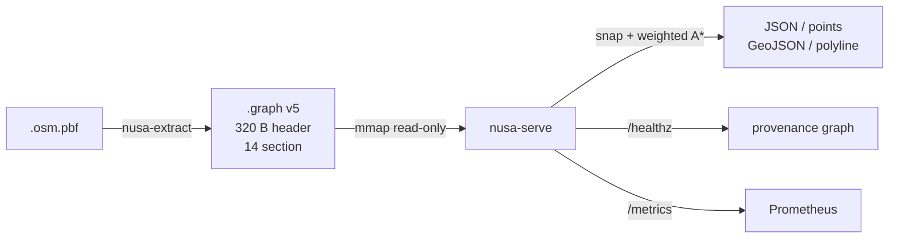

# Arsitektur

Dokumen ini menjelaskan implementasi yang ada di `internal/` dan `cmd/`, bukan
rencana. Angka kapasitas ada di [`BENCHMARKS.md`](BENCHMARKS.md); kontrak HTTP di
[`API.md`](API.md).

## Pipeline



Ekstraksi offline dan server online dipisahkan. Server tidak pernah menulis
graph, tidak butuh PBF, dan tidak butuh database. Satu graph bisa dibuka oleh
beberapa proses dengan profil berbeda.

## Batasan desain

- Wilayah: Indonesia, rentang latitude −12…8, longitude 93…142.
- Kontrak aplikasi: rute ≤100 km. Rute lebih panjang ditolak sebelum pencarian
  atau setelah jarak tempuh diketahui.
- Profil: mobil dan sepeda motor. Tidak ada truk, sepeda, atau pejalan kaki.
- Tidak ada traffic real-time, historis, atau machine learning.
- Tidak ada hierarchy (CH/MLD). Ini keputusan sadar: hierarchy menambah fase
  preprocessing dan struktur query yang jauh lebih besar.
- Tidak ada klaim akurasi ground truth. Evaluasi E1 hanya membandingkan dua
  engine pada graph OSM yang sama.

## Format graph v5

File little-endian, semua section ter-align, bisa di-`mmap` tanpa parsing:

```text
+-----------------------------+
| header 320 B                |
+-----------------------------+
| Lat      int32[nodeCount]   |  koordinat 1e-7 derajat
| Lon      int32[nodeCount]   |
| Off      uint32[node+1]     |  CSR edge range
| To       uint32[edgeCount]  |
| Len      uint16[edgeCount]  |  meter / 4
| Cls      uint8[edgeCount]   |  mobil: km/h * 2, 0 = tidak bisa dilalui
| MCls     uint8[edgeCount]   |  motor: km/h * 2, 0 = tidak bisa dilalui
| Ferry    uint32[ferryCount] |
| CLat     int32[coordCount]  |  geometri interior; saat ini 0
| CLon     int32[coordCount]  |
| GOff     uint32[cell+1]     |  offset byte ke GNodes
| GNodes   varint delta       |  node id per sel grid snap
| TurnOff  uint64[banCount]   |  (from edge, to edge) yang dilarang
| TurnTo   uint64[onlyCount]  |  successor yang diizinkan
+-----------------------------+
| metadata key=value          |  offset di header
| ban motor + only motor      |  offset di header
+-----------------------------+
```

Header menyimpan magic `RIDG` (identifier format, dipertahankan saat rename), versi, jumlah node/edge, bounding box, offset
section, hash PBF, waktu build, versi extractor, dan profil. `VersionMin = 5`:
file v1–v4 ditolak dan harus diekstrak ulang.

Ukuran per elemen:

| elemen | byte | catatan |
|---|---:|---|
| node | 12 | `Lat` + `Lon` |
| edge | 8 | `To` 4 + `Len` 2 + `Cls` 1 + `MCls` 1 |
| workspace slot | 12 | `keys` + `gs` + `came`, open addressing |
| header | 320 | tetap, bukan per node |

`Len` disimpan dalam satuan 4 m. Satu edge adalah satu hop node OSM, jadi
kesalahan kuantisasi maksimum 2 m per edge. Waktu tempuh **tidak disimpan**:
`time_ds = Len * 288 / class`, dengan `class = 2 × km/h`. Rumus ini eksak untuk
kecepatan bulat km/jam dan menghemat section waktu 4 B/edge.

`CLat`/`CLon` disediakan untuk geometri interior, tetapi extractor saat ini
menulis 0 karena setiap node OSM sudah menjadi node graph. Polyline memakai
koordinat node, bukan shape point terpisah.

### Invarian

- `Off[0] = 0`, `Off[nodeCount] = edgeCount`, monoton naik.
- `To[e] < nodeCount`; edge selalu berarah; jalan dua arah menjadi dua edge.
- `Len[e] > 0`; `Cls[e] > 0` untuk mobil; `MCls[e] > 0` untuk motor.
- `TurnOff`/`TurnTo` terurut; pencarian memakai binary search.
- `GOff` menunjuk ke dalam `GNodes`; setiap delta menghasilkan id yang valid.
- Graph dengan `edgeCount >= 2^28` ditolak karena workspace mengemas state edge
  dalam 28 bit. Graph nasional 112 juta edge masih jauh di bawah batas.
- File dibuka read-only; server tidak boleh mengubah byte apa pun.

## Ekstraksi

`nusa-extract` membaca PBF secara streaming, membangun node/way/relation, lalu
menulis graph. Tiga hal yang mahal:

1. **Way filtering.** Hanya way dengan tag jalan yang masuk profil. Motor
   memakai aturan akses yang berbeda dari mobil (`motorcycle`, `motor_vehicle`,
   `access`, `highway=*`, `ferry`).
2. **Restriction resolution.** Relasi `type=restriction` dipetakan dari way ke
   edge setelah CSR selesai. Via-node didukung penuh. Via-way yang lebih dari
   satu way diurutkan; jika rantainya tidak bisa dipastikan, rule dibuang
   konservatif. `restriction:conditional` dihitung sebagai statistik tetapi
   tidak dievaluasi.
3. **Hilbert ordering.** Node diurutkan dengan kurva Hilbert pada grid
   koordinat, lalu CSR dibangun ulang. Tujuannya locality halaman, bukan
   kualitas rute.

Provenance yang ditulis: SHA-256 PBF, waktu build, versi extractor, nama profil,
hash profil, dan ringkasan restriction. `/healthz` membacanya kembali.

Contoh:

```bash
bin/nusa-extract -pbf data/java-latest.osm.pbf -out data/java.graph \
  -workers 12 -grid 0.02
bin/nusa-graphinfo -graph data/java.graph
```

`-order osm` menghasilkan urutan id OSM untuk A/B; `-no-restrictions` untuk
debug; `-grid` mengatur sel snap (default 0.02°).

## Pencarian

### Weighted A*

State pencarian adalah **edge yang baru dilewati**, bukan node. Alasannya:
turn restriction adalah properti transisi `(edge masuk, edge keluar)`, dan
biaya belok butuh arah datang. State edge membuat keduanya bisa dihitung tanpa
tabel dense per node.

```text
g(edge)   = waktu edge + penalti belok + waktu ferry
h(node)   = jarak great-circle / kecepatan maksimum graph
f(edge)   = g + ε · h
```

- `ε = 1.5` default. `ε = 1.0` optimal tetapi jauh lebih lambat; `ε = 2.0`
  lebih cepat tetapi satu pasangan pada uji lama kehilangan 11% jarak.
- Penalti belok default `0.25`; biaya belok diambil dari tabel kelas jalan.
- Heuristik dibatasi kecepatan maksimum graph (bukan 130 km/jam global) agar
  motor tetap admissible.
- Bila budget habis, router mencoba ulang dengan ε lebih besar; hasilnya
  membawa `relaxed=true`, `epsilon`, dan `turn_penalty`.
- Bila pencarian tanpa restriction gagal, router boleh mencoba sekali dengan
  restriction dimatikan; hasilnya membawa `fallback=true`. Ini terlihat di
  response dan metrik.

### Workspace

Setiap query meminjam satu workspace dari pool global:

- tabel open-addressing `keys`/`gs`/`came`, 12 B/slot;
- mulai 65.536 slot (±0,75 MB), tumbuh sampai batas `-workspace-mb / -conc`;
- tabel dobel saat load factor 80%, lalu mengecil bila kapasitas >8× pemakaian;
- workspace idle >30 detik dikembalikan ke ukuran awal, sehingga RSS tidak
  menahan puncak query terakhir;
- query yang timeout mengembalikan workspace segera, tidak menahan slot.

Batas ekspansi default 4 juta edge dan budget lunak 60% dari `-timeout`.
Keduanya menghasilkan `422` deterministik, bukan OOM atau `504` acak.

### Multi-region dan ferry

Server bisa membuka beberapa file sekaligus (`-graph a.graph -graph b.graph`
atau `-graph 'data/*.graph'`). Untuk setiap endpoint, server memilih region
dengan jarak snap terdekat. Bila kedua endpoint jatuh di region berbeda:

1. coba satu region yang memuat keduanya (bbox saling tumpang tindih);
2. bila tidak ada, coba pasangan ferry yang dikenal (`connectors.go`);
3. bila tidak ada, `422 cross_region`.

Ini bukan router antarpulau umum. Konektor ferry adalah daftar eksplisit untuk
deployment Indonesia; jadwal dan musim tidak dimodelkan.

## Snapping

`SnapEdge(lat, lon, maxDist)`:

1. cari sel grid dan sel tetangga;
2. untuk setiap segmen, proyeksikan titik ke garis;
3. pilih segmen dengan jarak Euclidean minimum;
4. kembalikan titik proyeksi, edge, dan jarak.

Snapshot default 3.000 m. Titik yang lebih jauh ditolak `422 snap`, bukan
ditempel ke jalan puluhan kilometer jauhnya. Ini perbedaan penting dari OSRM
default: pada 79 pasangan E1 yang gagal, OSRM menempel target dengan median
15,3 km, p90 32,7 km, dan maksimum 44,6 km.

Untuk rute, snapping bekerja per segmen, bukan per node. Uji pada jalan dengan
segmen >150 m:

| metrik | snap ke node | snap ke ruas |
|---|---:|---:|
| p50 galat | 67,3 m | **16,1 m** |
| p95 galat | 114,0 m | **34,9 m** |

Sesudah snap, geometri bisa di-trim (buang spur dari titik awal/akhir) atau
diberi pin mentah (`pin=1`). `trimmed` dan `snap_*_m` selalu ada di response.

## Profil dan restriction

Satu artefak v5 menyimpan:

- `Cls`: kelas kecepatan mobil;
- `MCls`: kelas kecepatan motor, 0 berarti motor tidak boleh lewat;
- `TurnOff`/`TurnTo`: ban dan `only_*` mobil;
- section tambahan di header tail: ban dan `only_*` motor.

Server memilih profil saat start (`-profile car|motor`). Dua profil tidak boleh
berada di proses yang sama karena pemilihan region berbasis snap akan saling
menutupi; deployment memakai dua proses dan `nusa-gateway` memilih upstream dari
`?profile=`.

Restriction yang tidak bisa direpresentasikan (via-way bercabang, relasi rusak,
`restriction:conditional`) dicatat di statistik dan dibuang. Jumlahnya kecil,
tetapi ini berarti Nusapeta Route bisa melanggar larangan belok yang tidak terbaca;
`nusa-restcheck` mengukur kepatuhan pada graph uji.

Detail model motor dan batasnya: [`MOTOR-MODEL.md`](MOTOR-MODEL.md).

## Server dan gateway

`nusa-serve`:

- `net/http` + `ServeMux`, tanpa framework;
- `mmap` graph, `Router` per region, workspace pool dibagi semua region;
- gzip response, CORS `*`, ETag opsional;
- rate limit token bucket per IP (15/menit, burst 5);
- graceful shutdown 20 detik;
- `/metrics` Prometheus.

`nusa-gateway`:

- reverse proxy dua upstream (mobil/motor);
- `?profile=mobil|motor`, default mobil;
- `X-Route-Profile` ditambahkan;
- `/healthz` agregat kedua profil; `/metrics` bisa diblokir;
- tidak menyajikan halaman apa pun: demo peta adalah front end statis terpisah
  (`nusapeta/demo`) yang mem-proxy `/route` dan `/place` ke sini. Kolom
  "Cari tempat" di demo itu memanggil `/place/search` lalu mengisi titik A atau
  B, dan tanpa `-place` kolom itu dinonaktifkan sehingga peta tetap bisa dipakai
  lewat klik;
- opsional `-place`: upstream geocoder pihak lain dipasang di prefix `/place`
  (lihat [`API.md`](API.md) dan [`OPERATIONS.md`](OPERATIONS.md)). Prefix itu
  satu-satunya sinyal routing karena hostname publik hanya punya satu route
  tunnel; tanpa flag ini prefix tersebut menjawab `404` seperti path asing
  lainnya;
- rate limit token bucket per IP khusus `/place` (default 240/menit, burst 40),
  karena upstream geocoder memindai seluruh index dan plafon terukurnya
  sekitar 20 RPS.

## Yang sengaja tidak ada

- CH/MLD, customization, atau contraction;
- turn-by-turn instruction, lane guidance, traffic;
- geocoding, address parsing, POI di dalam `nusa-serve` dan `nusa-gateway`:
  index, builder, dan artefaknya tetap milik project lain. Gateway hanya
  meneruskan prefix `/place` ke upstream terpisah, jadi graph Nusapeta Route tidak
  bertambah besar dan image-nya tidak berubah;
- elevation, toll pricing, truck constraints;
- persisted query cache (hanya ETag/HTTP cache);
- database, message queue, sidecar.

Penambahan fitur harus membuktikan bahwa biaya RAM/artefak tetap dalam budget
di [`ROADMAP.md`](ROADMAP.md).
