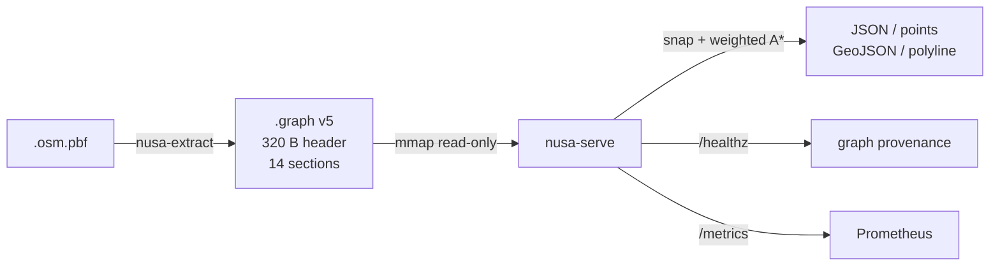

# Architecture

This document describes the implementation in `internal/` and `cmd/`, not a
plan. Capacity numbers are in [`BENCHMARKS.md`](../BENCHMARKS.md); the HTTP
contract is in [`API.md`](../API.md). The Indonesian original is
[`../ARCHITECTURE.md`](../ARCHITECTURE.md).

## Pipeline



Extraction is offline; the server is online. The server never writes the graph,
never needs the PBF, and never opens a database. Multiple processes can map one
graph with different profiles.

## Design limits

- Area: Indonesia, latitude −12…8, longitude 93…142.
- Application contract: routes up to 100 km. Longer routes are rejected before
  the search or once travel distance is known.
- Profiles: car and motorcycle. No truck, bicycle, or pedestrian.
- No real-time, historical, or machine-learned traffic.
- No hierarchy (CH/MLD). This is deliberate: hierarchy adds preprocessing and a
  much larger query structure.
- No ground-truth accuracy claim. E1 only compares two engines on the same OSM
  graph.

## Graph format v5

Little-endian, every section aligned, mappable without parsing:

```text
+-----------------------------+
| header 320 B                |
+-----------------------------+
| Lat      int32[nodeCount]   |  coordinates 1e-7 degrees
| Lon      int32[nodeCount]   |
| Off      uint32[node+1]     |  CSR edge range
| To       uint32[edgeCount]  |
| Len      uint16[edgeCount]  |  meters / 4
| Cls      uint8[edgeCount]   |  car: km/h * 2, 0 = impassable
| MCls     uint8[edgeCount]   |  motorcycle: km/h * 2, 0 = impassable
| Ferry    uint32[ferryCount] |
| CLat     int32[coordCount]  |  interior geometry; currently 0
| CLon     int32[coordCount]  |
| GOff     uint32[cell+1]     |  byte offset into GNodes
| GNodes   varint delta       |  node id per snap grid cell
| TurnOff  uint64[banCount]   |  forbidden (from edge, to edge)
| TurnTo   uint64[onlyCount]  |  allowed successor
+-----------------------------+
| metadata key=value          |  offsets in the header
| motorcycle ban + only       |  offsets in the header
+-----------------------------+
```

The header stores the magic `RIDG` (format identifier, preserved through the
rename), version, node/edge counts, bounding box, section offsets, PBF hash,
build time, extractor version, and profile. `VersionMin = 5`: v1–v4 files are
rejected and must be re-extracted.

Per-element sizes:

| Element | Bytes | Note |
|---|---:|---|
| node | 12 | `Lat` + `Lon` |
| edge | 8 | `To` 4 + `Len` 2 + `Cls` 1 + `MCls` 1 |
| workspace slot | 12 | `keys` + `gs` + `came`, open addressing |
| header | 320 | fixed, not per node |

`Len` is stored in 4 m units. One edge is one OSM node hop, so quantization
error is at most 2 m per edge. Travel time is **not** stored:
`time_ds = Len * 288 / class`, with `class = 2 × km/h`. The formula is exact for
integer km/h and saves a 4 B/edge time section.

`CLat`/`CLon` exist for interior geometry, but the extractor writes 0 because
every OSM node is already a graph node. Polylines use node coordinates, not a
separate shape-point table.

### Invariants

- `Off[0] = 0`, `Off[nodeCount] = edgeCount`, monotonically increasing.
- `To[e] < nodeCount`; edges are directed; a two-way road becomes two edges.
- `Len[e] > 0`; `Cls[e] > 0` for cars; `MCls[e] > 0` for motorcycles.
- `TurnOff`/`TurnTo` are sorted; lookup uses binary search.
- `GOff` points inside `GNodes`; every delta produces a valid id.
- Graphs with `edgeCount >= 2^28` are rejected because the workspace packs edge
  state into 28 bits. The national graph's 112 million edges is far below the
  limit.
- The file is opened read-only; the server must not modify any byte.

## Extraction

`nusa-extract` streams the PBF, builds nodes/ways/relations, and writes the
graph. Three expensive parts:

1. **Way filtering.** Only ways with road tags enter the profile. Motorcycles
   use different access rules from cars (`motorcycle`, `motor_vehicle`,
   `access`, `highway=*`, `ferry`).
2. **Restriction resolution.** `type=restriction` relations are mapped from
   ways to edges after CSR construction. Via-node is fully supported. Via-way
   chains longer than one way are ordered; if the chain cannot be proven, the
   rule is discarded conservatively. `restriction:conditional` is counted as a
   statistic but not evaluated.
3. **Hilbert ordering.** Nodes are sorted with a Hilbert curve on the coordinate
   grid, then CSR is rebuilt. The goal is page locality, not route quality.

Written provenance: PBF SHA-256, build time, extractor version, profile name,
profile hash, and restriction summary. `/healthz` reads it back.

Example:

```bash
bin/nusa-extract -pbf data/java-latest.osm.pbf -out data/java.graph \
  -workers 12 -grid 0.02
bin/nusa-graphinfo -graph data/java.graph
```

`-order osm` produces OSM id order for A/B tests; `-no-restrictions` is for
debugging; `-grid` sets the snap cell (default 0.02°).

## Search

### Weighted A*

The search state is the **edge just traversed**, not the node. Turn restrictions
are properties of the `(incoming edge, outgoing edge)` transition, and turn cost
needs the incoming direction. Edge state makes both computable without a dense
per-node table.

```text
g(edge)   = edge time + turn penalty + ferry time
h(node)   = great-circle distance / graph maximum speed
f(edge)   = g + ε · h
```

- `ε = 1.5` default. `ε = 1.0` is optimal but much slower; `ε = 2.0` is faster
  but one pair in an old test lost 11% distance.
- Turn penalty default `0.25`; turn cost comes from the road-class table.
- The heuristic is capped at the graph maximum speed (not a global 130 km/h) so
  the motorcycle profile stays admissible.
- When the budget runs out, the router retries with a larger ε; the result
  carries `relaxed=true`, `epsilon`, and `turn_penalty`.
- When a search with restrictions fails, the router may try once with
  restrictions disabled; the result carries `fallback=true`. This is visible in
  responses and metrics.

### Workspace

Each query borrows one workspace from a global pool:

- open-addressing tables `keys`/`gs`/`came`, 12 B/slot;
- starts at 65,536 slots (±0.75 MB), grows up to `-workspace-mb / -conc`;
- tables double at 80% load, then shrink when capacity is >8× usage;
- idle workspaces older than 30 s return to the initial size, so RSS does not
  retain the last query's peak;
- timed-out queries return the workspace immediately and do not hold a slot.

The default expansion limit is 4 million edges and the soft budget is 60% of
`-timeout`. Both produce a deterministic `422`, not an OOM or a random `504`.

### Multi-region and ferries

The server can open several files (`-graph a.graph -graph b.graph` or
`-graph 'data/*.graph'`). For each endpoint it selects the region with the
nearest snap. If the endpoints fall in different regions:

1. try one region that contains both (overlapping bboxes);
2. otherwise try known ferry pairs (`connectors.go`);
3. otherwise return `422 cross_region`.

This is not a general inter-island router. Ferry connectors are an explicit
list for Indonesian deployments; schedules and seasons are not modeled.

## Snapping

`SnapEdge(lat, lon, maxDist)`:

1. find the grid cell and neighboring cells;
2. project the point onto each segment;
3. choose the segment with minimum Euclidean distance;
4. return the projected point, edge, and distance.

Default snap distance is 3,000 m. Farther points return `422 snap` instead of
being attached to a road tens of kilometers away. This differs from OSRM's
default: among the 79 failed E1 pairs, OSRM attached targets at a median of
15.3 km, p90 32.7 km, and maximum 44.6 km.

For routing, snapping works per segment, not per node. On roads with segments
longer than 150 m:

| Metric | Snap to node | Snap to segment |
|---|---:|---:|
| p50 error | 67.3 m | **16.1 m** |
| p95 error | 114.0 m | **34.9 m** |

After snapping, geometry may be trimmed (remove the spur at each end) or given
raw pins (`pin=1`). `trimmed` and `snap_*_m` are always present in the response.

## Profiles and restrictions

One v5 artifact stores:

- `Cls`: car speed class;
- `MCls`: motorcycle speed class, 0 means motorcycles may not pass;
- `TurnOff`/`TurnTo`: car bans and `only_*`;
- extra header-tail sections: motorcycle bans and `only_*`.

The server selects a profile at startup (`-profile car|motor`). Two profiles
must not share a process because snap-based region selection would mask one
another; deployment uses two processes and `nusa-gateway` selects the upstream
from `?profile=`.

Restrictions that cannot be represented (branching via-way, broken relations,
`restriction:conditional`) are counted and discarded. The count is small, but
it means Nusapeta Route can violate a turn ban that it could not read;
`nusa-restcheck` measures compliance on test graphs.

Motorcycle model limits: [`MOTOR-MODEL.md`](../MOTOR-MODEL.md).

## Server and gateway

`nusa-serve`:

- `net/http` + `ServeMux`, no framework;
- `mmap` graph, one `Router` per region, a workspace pool shared by all regions;
- gzip responses, CORS `*`, optional ETag;
- per-IP token-bucket rate limit (15/min, burst 5);
- graceful shutdown, 20 s;
- `/metrics` in Prometheus format.

`nusa-gateway`:

- reverse proxy for two upstreams (car/motorcycle);
- `?profile=mobil|motor`, default `mobil`;
- adds `X-Route-Profile`;
- aggregate `/healthz` for both profiles; `/metrics` can be blocked;
- serves the map demo from `web/`; the "Cari tempat" field calls
  `/place/search` and fills point A or B; without `-place` the field is disabled
  and the map still works by clicking;
- optional `-place`: a third-party geocoder upstream is mounted at `/place`
  (see [`API.md`](../API.md) and [`OPERATIONS.md`](../OPERATIONS.md)). The prefix is
  the only routing signal because the public hostname has one tunnel route;
  without the flag it returns `404` like any unknown path;
- a separate per-IP token bucket for `/place` (default 240/min, burst 40),
  because the geocoder upstream scans the whole index and its measured ceiling
  is about 20 RPS.

## Deliberately absent

- CH/MLD, customization, or contraction;
- turn-by-turn instructions, lane guidance, traffic;
- geocoding, address parsing, or POIs inside `nusa-serve` and `nusa-gateway`:
  the index, builder, and artifacts belong to another project. The gateway only
  forwards the `/place` prefix to a separate upstream, so the routing graph
  does not grow and the image does not change;
- elevation, toll pricing, truck constraints;
- a persisted query cache (only ETag/HTTP cache);
- a database, message queue, or sidecar.

New features must prove that RAM/artifact cost stays within the budget in
[`ROADMAP.md`](../ROADMAP.md).
